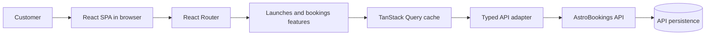

# AstroBookings Client Architectural Design Document

Architecture for a React client that consumes the fictional AstroBookings API
for launch discovery and customer bookings.

### Table of Contents
- [Stack and tooling](#stack-and-tooling)
- [Systems Architecture](#systems-architecture)
- [Software Architecture](#software-architecture)
- [Architecture Decision Record](#architecture-decision-record)

## Stack and tooling

### Technology Stack
- TypeScript, React, and Vite for the browser application.
- TanStack Query for server-state fetching, caching, mutation state, and query invalidation.
- React Router for catalogue, booking, confirmation, and history routes.
- Tailwind CSS for responsive styling and accessible state presentation.
- Vitest for unit tests; Playwright for browser-level journeys.
- The AstroBookings API is the only persistence system in the initial scope. No client database or local booking persistence is required.
- The integration API is the local `astro-bookings-demo` repository, built with
  `npm run build` and started with `npm start` on port 3000 by default.

### Development Tools
- npm scripts defined by the project package manifest.
- VS Code and the repository `.agents` workflows.
- Local development uses Vite; production delivery is a static build served by a hosting provider.
- CI should run type checking/build, Vitest, and Playwright with an API mock or configured test API.

## Systems Architecture

The browser is a single-page client. It calls the configured API directly over
HTTP. The API remains authoritative for launch availability, booking creation,
and booking status.

The client must treat availability as potentially stale: it validates locally
for immediate feedback, then surfaces the API response when a booking conflicts
with changed availability.

## Software Architecture

The application uses feature-oriented modules with a thin composition root:

- `api/`: typed transport functions, API error normalization, and environment configuration.
- `types/`: transport and domain types shared across features.
- `features/launches/`: launch queries, cards/detail presentation, and availability rules.
- `features/bookings/`: booking mutation, confirmation/status, and history query/presentation.
- `pages/`: route-level composition and page state handling.
- `components/`: reusable layout, feedback, form, and accessibility primitives.
- `App.tsx`: providers and route configuration.

Data flows from query hooks into presentational components. Mutations invalidate
launch and booking queries after a successful response. Forms own transient
input validation; API errors are normalized by the adapter and rendered by
feature-level error states. No component calls `fetch` directly.

## Architecture Decision Record

### ADR 1: Use a browser SPA with a typed API boundary
- **Decision**: Build a React/Vite SPA and isolate HTTP details behind a typed adapter.
- **Status**: Accepted
- **Context**: The briefing selects React + Vite + TypeScript and requires direct API consumption.
- **Consequences**: The app is easy to run and test, while API changes are localized; CORS and API availability remain deployment concerns.

### ADR 2: Treat server state as authoritative
- **Decision**: Use TanStack Query and invalidate relevant queries after mutations rather than maintaining a second booking store.
- **Status**: Accepted
- **Context**: Launch seats and booking status are owned by the API and can change between reads.
- **Consequences**: The UI needs loading, stale, retry, and conflict states, but avoids duplicated persistence logic.

### ADR 3: Use the API's email-based customer identity
- **Decision**: Consume the customer and booking context exposed by the API using customer email, without inventing an authentication system.
- **Status**: Accepted
- **Context**: The API accepts `customerEmail` when creating bookings and exposes customer and booking-history endpoints by email.
- **Consequences**: The initial client can implement customer selection by email without authentication; the API contract remains the source of truth.
