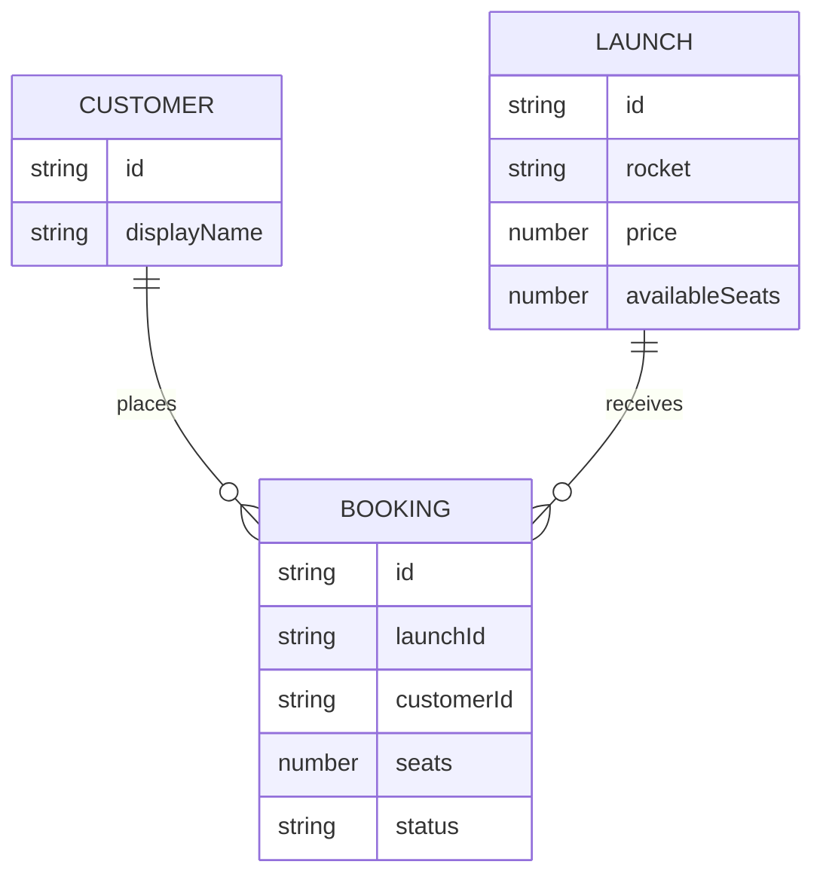

# AstroBookings Client Domain Model

The client displays API entities; it does not persist them locally.

`Customer` fields and the mechanism for selecting the current customer are
API-contract dependencies because the briefing does not define authentication.
The API remains the source of truth for booking status and seat availability.
